# PetStore
宠物门店经营管理系统
亮点：销售与库存联动、进货自动记账、 退换与退款关联、员工个人业绩、ECharts 经营分析、滞销识别与客户分层、宠物档案年龄计算；
角色：员工、管理员；

所有源码均本人开发，项目是前后端分离的，所有的项目都具备了完整的业务逻辑，不仅仅局限于基础的增删改查（CRUD）操作，系统亮点众多。

本文注重于计算机毕业设计选题指导，列出题目均有源码， 大家可以去【公众号】(毕业终点站)获取或者加我【qq】(2112698948)提意见(别忘记Star哟)。备注：git

声明：仅用于学习使用，请勿用于任何商业行为！

1.系统非商用，非开源，非无偿。

2.由本人开发，如需源码，请联系以下方式，qq:2112698948。

3.项目有很多，并未全部上传，如果未找到想要的，可直接咨询。

# 宠物门店经营管理系统

> B/S 前后端分离 · 管理员端 + 员工端 · 双角色与业务权限控制
>
> Spring Boot 3 + Vue 3 + Vite + Element Plus + MyBatis-Plus + MySQL 8 + ECharts

一套给宠物门店用的经营管理系统：员工在门店前台开单、查商品库存、维护客户与宠物档案、登记出入库、跟进自己的订单和退换申请；管理员在后台管商品与价格、盯库存预警、审退换单、看收支与经营数据。开单会扣库存、入库会记采购支出、退款会生成支出记录——卖货、备货、算账三件事在同一条数据线上。

---

## 一、技术栈

| 层次 | 选型 |
| :--- | :--- |
| 架构 | B/S、MVC、前后端分离、管理员端 + 员工端、角色区分与业务权限控制 |
| 运行环境 | Windows |
| 开发工具 | IDEA、JDK 17、Maven、MySQL 8、Node.js |
| 后端 | Java、Spring Boot 3、Spring MVC、MyBatis-Plus、MySQL、JWT、Jackson |
| 前端 | Vue 3、Vite、Element Plus、Vue Router、Pinia、Axios、ECharts、SCSS |
| 编辑与数据处理 | AiEditor 富文本编辑器、星火 AI 后端代理、Apache POI 表格导出、CSV 导出、浏览器小票打印 |

## 二、角色与功能范围

| 角色 | 主要使用范围 |
| :--- | :--- |
| 员工 | 工作首页；销售开单（选客户、快速新增客户、多商品加购、改数量与优惠、提交订单、打印小票）；商品浏览与库存查看；客户查询与快速新增、宠物档案维护；入库与出库登记；我的订单与明细；退换申请；个人业绩（今日/本周/本月、近 7 天与近 30 天趋势、热销商品、客户转化、复购、订单状态、销售时段） |
| 管理员 | 首页控制台；账号管理（管理员与员工账号、密码重置、导出）；商品分类与商品资料（编码、供应商、进销价格、图片、富文本详情）；库存管理（出入库记录、库存查询、预警阈值设置、批量阈值调整、导出）；客户管理；宠物档案；销售订单（完成、取消、导出）；退换审核（通过、驳回）；财务管理（收入、支出、客户消费、收支流水）；经营分析；数据大屏 |

## 三、功能亮点

- **销售与库存联动**：开单时校验库存并扣减，同时生成一条销售出库记录；待处理订单取消后库存回补，订单完成时登记销售收入。开单、扣库、记账三步同步完成，不用另外补录。
- **进货自动记账**：入库记录直接关联进货支出，按商品、数量、进货单价计采购成本，库存变动和资金支出能对上账。
- **退换与退款关联**：退换申请挂在原销售订单与商品明细上，审核通过后商品回库；退货退款按原订单实付单价乘退货数量计算，并生成退款支出记录。
- **员工个人业绩**：按经办员工统计已完成订单，给出销售额、订单量、客单价、成交客户、客户转化率、复购客户与销售时段分布。
- **ECharts 经营分析**：销售、商品、客户、收支、库存五个视角出图，含趋势、排行榜、分类占比与大屏看板，支持按时间范围筛选。
- **滞销识别与客户分层**：按近 30 天、60 天、90 天识别无销售商品；结合消费金额、购买频次与复购情况看客户。
- **宠物档案年龄计算**：宠物关联主人档案，按出生日期自动算年龄，配合体重、照片和健康备注持续维护。

---

## 四、界面展示

> 说明：源文档首图为登录页，未提供独立的系统总览图，故「登录入口」单独成节，首图不充当总览横幅。全部截图均为 2.16–2.37 比例的桌面宽屏后台，一律全宽单图排布以保证表格文字清晰。

### 4.1 登录入口

左侧是奶油底色上的门店标识与一句「用心呵护每一个小生命」，下面四行能力点：宠物档案管理、商品库存管理、销售订单追踪、财务收支分析。右侧登录卡标题「欢迎回来 / 登录宠物门店经营管理系统」，依次是账号、密码、角色下拉与验证码，底部「还没有账号？立即注册」与「登录遇到问题」。

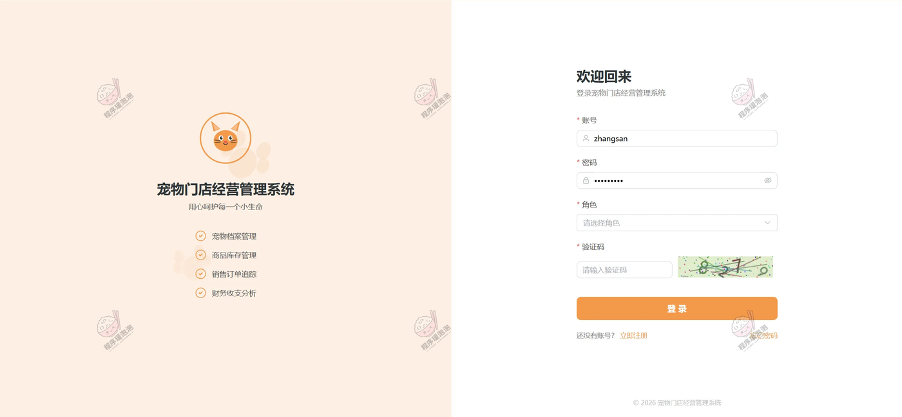

两个角色共用这一个入口，靠「角色」下拉区分：选员工进门店前台工作台，选管理员进后台控制台。

### 4.2 员工端

顶栏标「宠物门店经营管理系统 / Pet Store Operations - Staff Console」，右上角是当前登录人 zhangsan 与「员工」身份标。左侧菜单十项：工作台、销售开单、商品查询、客户查询、宠物管理、出入库操作、我的订单、退换申请、业绩看板、个人信息。

#### 销售开单

页面分左右两栏：左边选客户（可「选择客户」或「快速新增客户」）再逐条加商品明细，右边是金额结算区（原价合计、折扣合计、实付金额）与「提交待处理 / 提交并完成」两个出口。

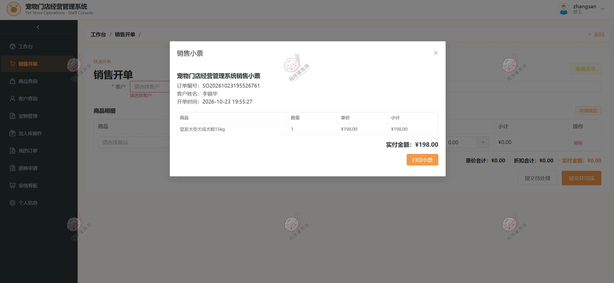

提交后弹出一张可打印的销售小票：订单编号 SO20261023195526761、客户姓名李锦华、开单时间 2026-10-23 19:55:27，明细一行「皇家大型犬成犬粮15kg × 1 × ¥198.00」，实付金额 ¥198.00。两个出口对应两种业务节奏——「提交待处理」先占库存等客户付款，「提交并完成」当场扣库并登记收入。

#### 商品查询

按商品名称与商品分类查。表格列是商品信息（图、名称、分类标签）、当前库存、销售价、库存状态、详情。

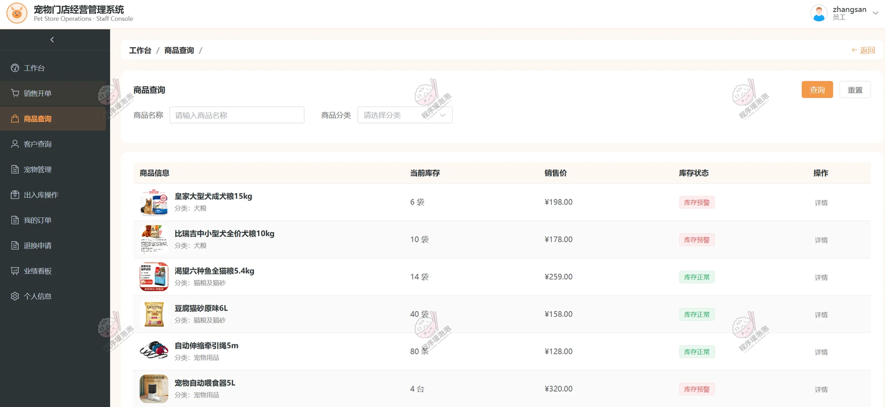

六条商品里状态泾渭分明：皇家大型犬成犬粮15kg 6 袋、比瑞吉中小型犬全犬粮10kg 10 袋、宠物自动喂食器5L 4 台标「库存预警」；渴望六种鱼全猫粮5.4kg 14 袋、豆腐猫砂原味6L 40 袋、自动伸缩牵引绳5m 80 条标「库存正常」。同样卖 ¥198 的犬粮剩 6 袋要预警，这个阈值在管理员端「库存预警」里能看到是 10 袋。

#### 客户查询

按客户姓名与手机号查，表格给客户信息、性别、地址、备注、创建时间，右上角显示「共 40 位客户」，左上角一枚「+快速添加客户」。

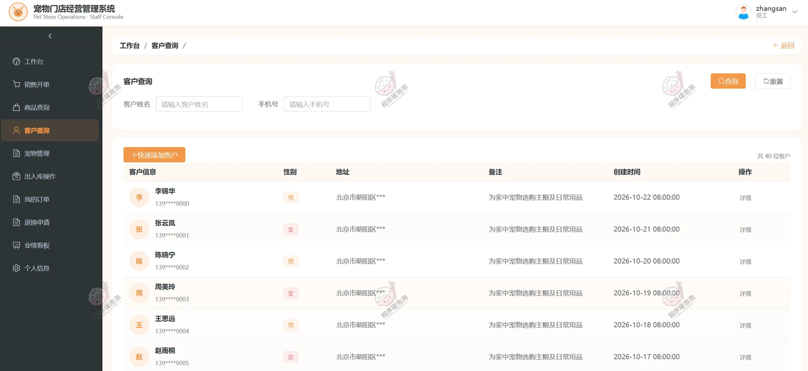

演示数据从 2026-10-22 08:00:00 往前一天一条排开，李锦华（139****9000）、张云凤、陈瑞宁、周美玲、王思远、赵雨桐，备注统一写着「为家中宠物选购主粮及日常用品」——门店客户多是给宠物备粮的复购客。开单页的「快速新增客户」就落在这里建档案。

#### 宠物管理

按宠物名称、主人姓名、宠物类型筛。表格列是宠物信息（照片、名字、主人与电话、品种）、宠物类型、性别、出生日期/年龄、体重、健康备注、操作（详情/编辑/删除），右上角「共 12 条数据」。

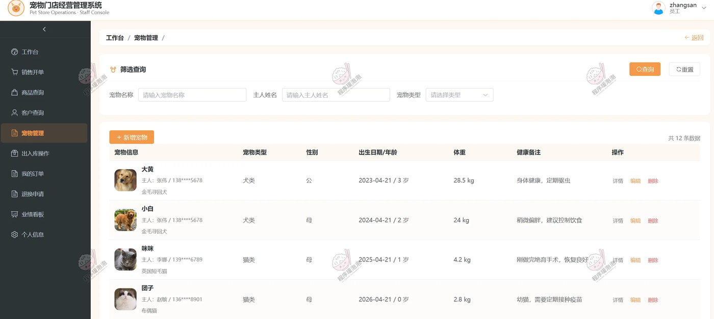

年龄不是手填的，是拿出生日期算出来的：大黄 2023-04-21 出生显示 3 岁、小白 2024-04-21 显示 2 岁、咪咪 2025-04-21 显示 1 岁、团子 2026-04-21 显示 0 岁——四个日期刚好各差一年，年龄也跟着一年一档。健康备注写得挺具体：大黄「身体健康，定期驱虫」、小白「稍微偏胖，建议控制饮食」、咪咪「刚做完绝育手术，恢复良好」、团子「幼猫，需要定期接种疫苗」。

#### 出入库操作

顶部按商品名称、记录类型、时间范围筛，下面两个标签「商品入库 / 商品出库」，右上角注明「仅展示我操作的记录，共 87 条」。

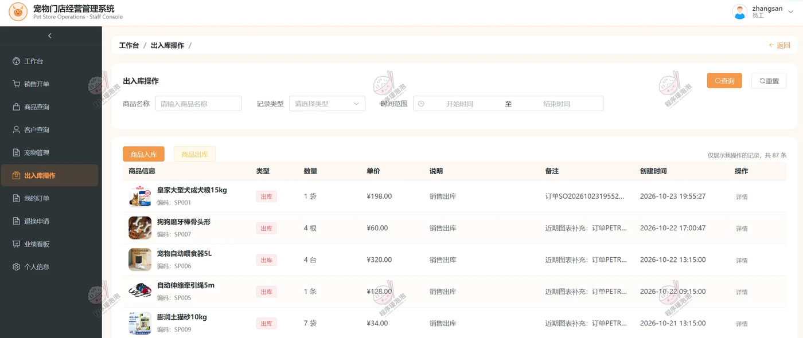

表格列是商品信息（含 SP 编码）、类型、数量、单价、说明、备注、创建时间。出库那几行的「说明」写得很清楚：第一条是「销售出库」，备注直接挂着订单号 SO2026102319552…，时间 2026-10-23 19:55:27——正是销售开单里那张小票的开单时刻，说明开单确实自动生成了一条出库记录。下面几条备注都是「近7天图表补充：订单PETR…」，是演示数据的补录。编码对应关系：SP001 皇家大型犬成犬粮15kg、SP005 自动伸缩牵引绳5m、SP006 宠物自动喂食器5L、SP007 狗狗磨牙骨头、SP009 膨润土猫砂10kg。

#### 我的订单

按订单编号、订单状态、时间范围筛，右上角「共 96 笔订单」，页头写着「仅展示我创建的订单」。

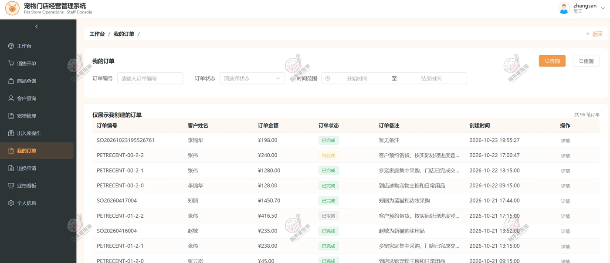

表格给订单编号、客户姓名、订单金额、订单状态、订单备注、创建时间。「已完成」绿标、「待处理」黄标、「已取消」灰标，三种状态一眼分开。第一行就是那张小票对应的 SO20261023195526761（李锦华 ¥198.00 已完成 暂无备注）；往下是批量与预约备货类订单——张伟 ¥1280.00「多宠家庭集中采购，门店已完成交…」、郑聪 ¥1450.70「郑聪为蓝猫和边牧采购」、赵敏 ¥235.00「赵敏为新猫购买用品」。带 PETRECENT 前缀的单号是客户预约备货单，金额有整有零（¥240.00、¥238.00、¥416.50、¥45.00），能看到议价与凑单的痕迹。

#### 退换申请

按订单编号、退换类型、处理状态、时间范围筛，右上角「共 8 条数据」，左上角「发起退换申请」。

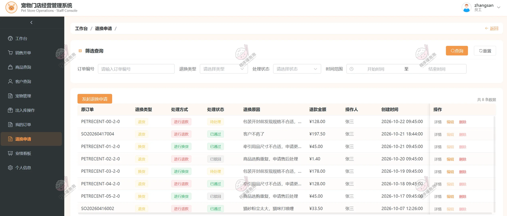

表格列是原订单、退换类型（退货/换货）、处理方式（进行退款/进行换货）、处理状态（待处理/已通过/已驳回）、退换原因、退款金额、操作人、创建时间、操作。八条里三种状态都有：PETRECENT-00-2-0 退货待处理 ¥128.00「包装开封时发现规格不合适…」、SO20260417004 退货已通过 ¥197.50「客户不药了」、PETRECENT-01-2-0 换货已通过 ¥45.00、PETRECENT-02-2-0 换货已驳回 ¥1.40「商品选购重复，申请售后处理」。退款金额不是随手写的，是从原订单实付单价乘退货数量算出来的——同一个商品在不同单上退的钱不一样，就是实付价不一样。

#### 业绩看板

页头写「个人销售概览」，右侧注明「按今日、本周、本月汇总已完成订单的销售表现」。三张卡：

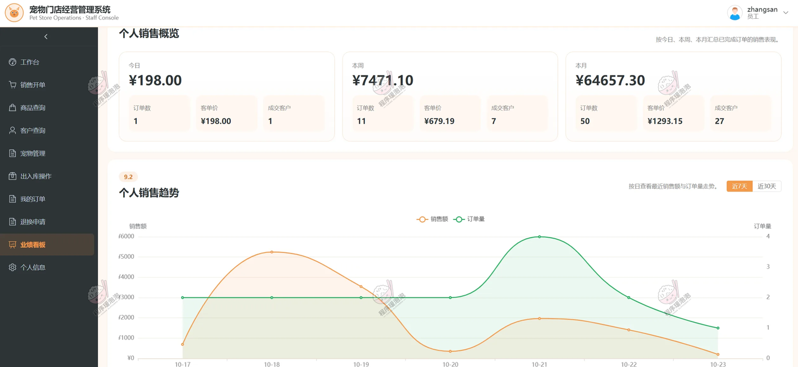

- 今日：销售额 ¥198.00、订单数 1、客单价 ¥198.00、成交客户 1
- 本周：销售额 ¥7471.10、订单数 11、客单价 ¥679.19、成交客户 7
- 本月：销售额 ¥64657.30、订单数 50、客单价 ¥1293.15、成交客户 27

客单价是拿销售额除订单数算的：7471.10 ÷ 11 = 679.19，64657.30 ÷ 50 = 1293.15，两边对得上。下面是「个人销售趋势」，可切「近 7 天 / 近 30 天」，橙色折线是销售额（左轴 ¥0–6000）、绿色折线是订单量（右轴 0–4），10-17 到 10-23 一路排开，10-18 销售额到峰值、10-21 订单量到 4 单。

### 4.3 管理员端

顶栏是 admin 与「管理员」身份标，左侧菜单按业务分组：宠物管理（宠物类型、宠物档案）、商品管理（商品分类、商品列表、出入库记录、库存列表、库存预警）、客户管理（客户信息、消费记录）、销售管理（销售订单、退换单管理）、数据分析（销售分析、商品分析、客户分析、数据可视化）、财务管理（收入记录、支出记录、收支流水）、系统管理（管理员管理、员工管理）。

> 说明：管理员端的「宠物档案」与员工端「宠物管理」是同一张列表——同样的 12 条宠物数据、同样的详情/编辑/删除三个操作，只有左侧菜单与页头路径不同，故未重复列出，宠物档案的界面与数据见 4.2。

#### 商品列表

按商品名称与所属分类筛，右上「已选 0 项，共 15 条数据」，左上「+新增商品」与「批量删除」。

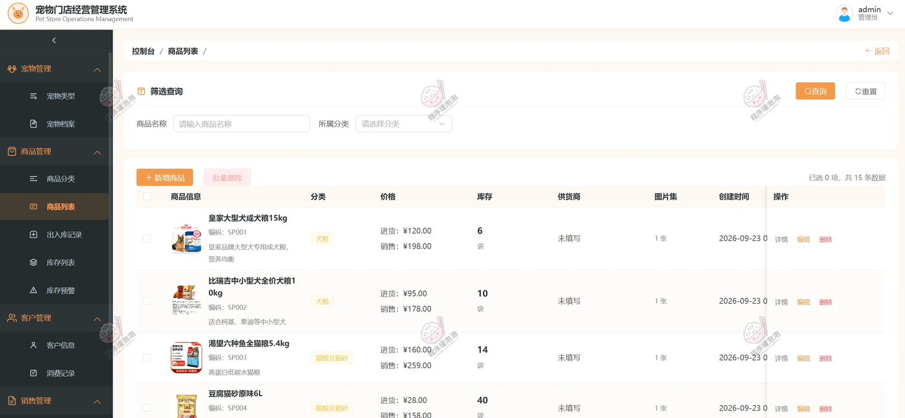

表格比员工端多了进货价、供货商、图片集和创建时间：皇家大型犬成犬粮15kg（SP001，犬粮）进货 ¥120.00、销售 ¥198.00、库存 6 袋；比瑞吉中小型犬全犬粮10kg（SP002）进 ¥95.00、售 ¥178.00、10 袋；渴望六种鱼全猫粮5.4kg（SP003）进 ¥160.00、售 ¥259.00、14 袋；豆腐猫砂原味6L（SP004）进 ¥28.00、售 ¥158.00、40 袋。进货价只在后台可见，员工端的商品查询看不到这一列——价格成本对前台是遮起来的。

#### 库存预警

按商品名称与商品分类筛，顶部一段「补货处理指引」说明：预警支持阈值提醒与快速跳转入库登记，已触发的商品可直接点「去登记入库」补录到货。右上角「预警商品 8 个，共 15 条数据」，左上「按分类批量设置」。

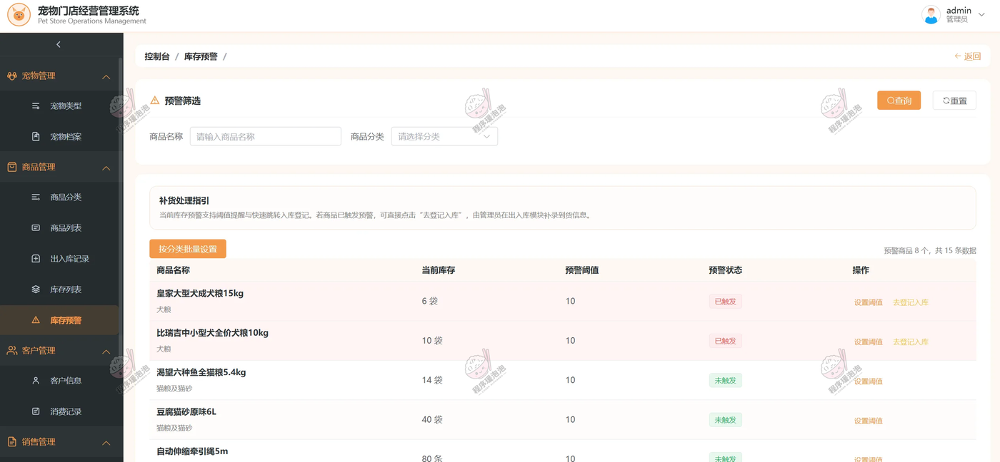

表格列是商品名称（含分类）、当前库存、预警阈值、预警状态、操作（设置阈值 / 去登记入库）。判定规则在数据里写得很直白：几行商品的阈值都设成 10，皇家大型犬成犬粮 6 袋「已触发」、比瑞吉中小型犬全犬粮 10 袋也「已触发」、渴望六种鱼全猫粮 14 袋「未触发」——库存小于等于阈值就报警，正好等于阈值的 10 袋同样算触发，和员工端商品查询里那两条「库存预警」的标法一致。

#### 销售订单

按订单编号、客户姓名、订单状态与时间范围筛，右上「已选 0 项，共 199 条数据」，左上「+新增订单」「批量删除」「导出订单」。

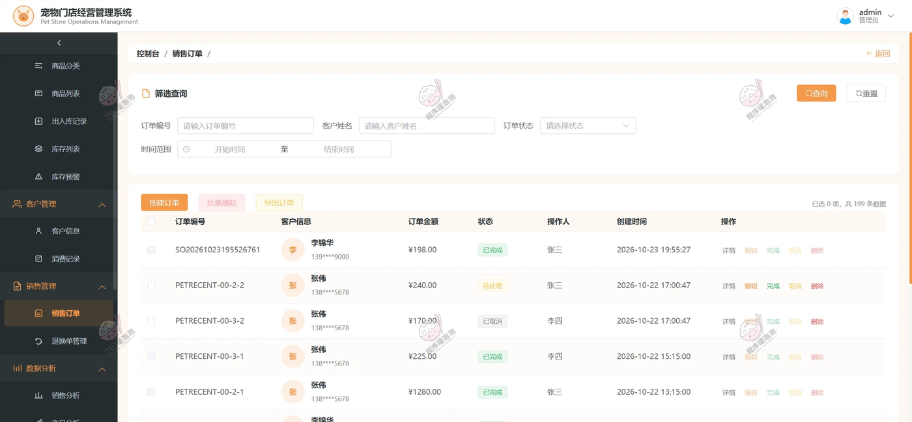

表格列比员工端多了「操作人」：SO20261023195526761 李锦华（139****9000）¥198.00 已完成 操作人张三；PETRECENT-00-2-2 张伟 ¥240.00 待处理 张三；PETRECENT-00-3-2 张伟 ¥170.00 已取消 李四；PETRECENT-00-3-1 张伟 ¥225.00 已完成 李四；PETRECENT-00-2-1 张伟 ¥1280.00 已完成 张三。同一批单号在员工端「我的订单」里也在，员工看到的是自己经办的 96 笔，管理员看到的是全店 199 笔，操作列还多一个「完成」——待处理订单由管理员点完成才登记收入。

#### 退换单管理

筛选条件与员工端一致，右上「共 15 条数据」。

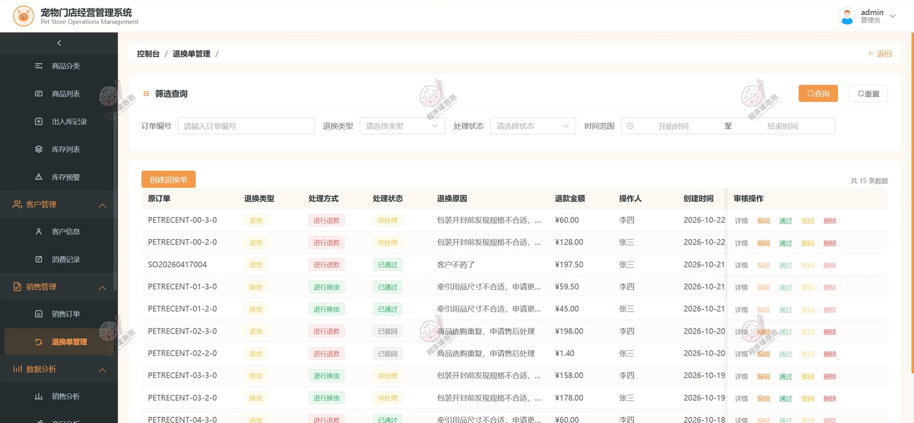

表格在员工端的基础上把「操作」拆成两列——「操作」是详情/编辑/删除，「审核操作」才是通过/驳回。演示数据前几行：PETRECENT-00-3-0 退货待处理 ¥60.00 李四、PETRECENT-00-2-0 退货待处理 ¥128.00 张三、SO20260417004 退货已通过 ¥197.50 张三、PETRECENT-01-3-0 换货已通过 ¥59.50 李四、PETRECENT-02-3-0 退货已驳回 ¥198.00 李四。员工端只能看到自己经办的 8 条，管理员这 15 条是全店口径，审核动作也只在这里。

#### 数据分析

顶部四张卡：消费客户 24 人（消费次数>1）、净利润 ¥82971.00（收入-支出）、库存预警 8 项（低于阈值商品）、待处理 32 单（未完成订单）。右侧标签可切「经营总览 / 商品动销 / 客户行为 / 财务趋势 / 库存预警」。

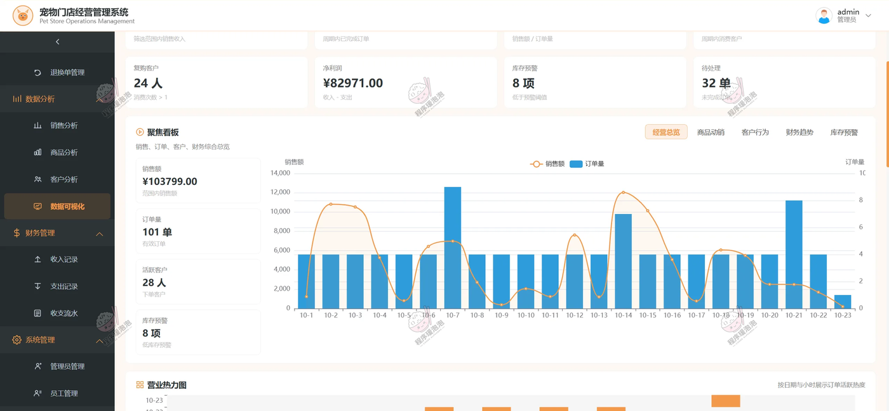

下面是「聚焦看板」，左侧四个数：销售额 ¥103799.00、订单量 101 单、活跃客户 28 人、库存预警 8 项；右侧一张组合图，蓝色柱是订单量（右轴 0–10）、橙色折线是销售额（左轴 0–14,000），横轴 10-1 到 10-23，10-7 那天订单量 8 单最高，10-14 销售额最高。底部还有一块「营业热力图」，按日期与小时展示订单活跃热度。

库存预警这一项前后两处都是 8，和「库存预警」页右上角的「预警商品 8 个」是同一个数；净利润 82971.00 与销售额 103799.00 之间差 20828，就是同期支出——这套账在财务管理里的收入记录与支出记录两张表能核对上。

---

## 五、核心流程说明

**1. 开单与扣库存**
员工在销售开单页选客户（或现场新增）、逐条加商品、改数量与优惠，系统按当前库存校验后提交。「提交待处理」只占库存不下账，「提交并完成」当场扣减库存、写入销售出库记录并登记销售收入。小票随提交生成，浏览器直接打印。

**2. 取消与回补**
待处理订单被取消时，占用的库存原路补回，出库记录随之冲销；订单完成时才真正登记收入。库存数字因此不会因为挂单而虚减。

**3. 入库与采购支出**
员工或管理员登记入库，填商品、数量、进货单价与备注；系统按进货单价乘数量记一笔采购支出，关联到入库记录。要查某批货花了多少钱，从入库记录就能翻到对应的支出条目。

**4. 退换与退款**
员工从原订单发起退换，选退换商品、填原因；管理员在退换单管理里审核。通过后商品回库，退货按原订单实付单价乘退货数量算退款金额，并生成退款支出记录；驳回则只留处理痕迹不退款。

**5. 库存预警与补货**
每件商品有独立阈值（默认 10），库存小于等于阈值就进「库存预警」，状态标「已触发」；管理员可单条设置阈值，也能按分类批量调整，再从「去登记入库」直接跳去补货。

**6. 宠物档案与年龄**
客户与宠物档案关联，录入出生日期后年龄自动算出并随日期滚动；体重、照片、健康备注作为持续维护的字段，员工在客户服务里就能补录，管理员在宠物档案里统一查看。

**7. 个人业绩与经营分析**
业绩按经办员工统计已完成订单，出今日/本周/本月三档与 7 天、30 天趋势；管理员侧的经营分析按销售、商品、客户、财务、库存五个标签分场景，滞销识别按 30/60/90 天三个窗口筛无销售商品，客户侧按消费金额与频次分层。

---

## 六、说明

> 文档展示 14 张截图，需要了解更多，请联系我。

